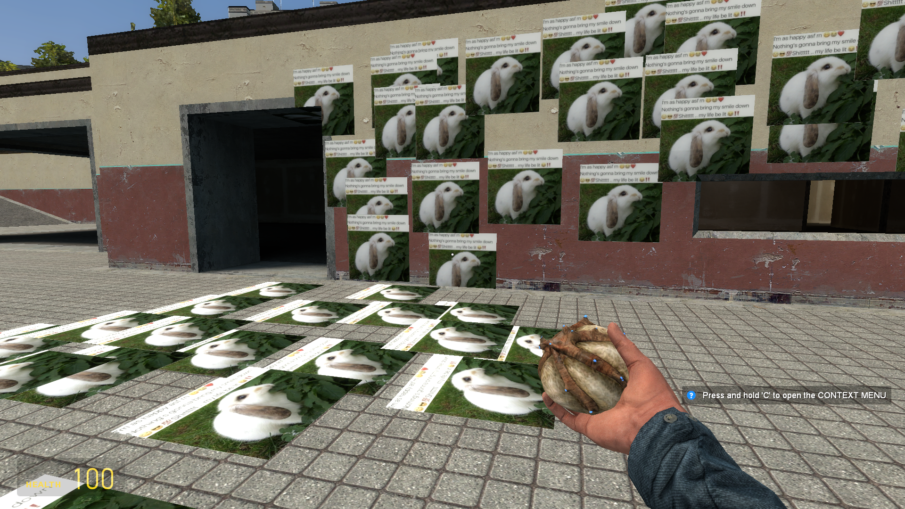

# BunnZooka-GMod

A Garry's Mod weapon that stamps a meme on whatever you shoot. Left click fires the BunnZooka and leaves a bunny sticker on walls, floors and props. Right click wipes the stickers.

My first Garry's Mod addon, built to learn GLua, the client/server split, and how a game engine turns art into textures.

## Install

1. Download this repo (Code → Download ZIP) and unzip it
2. Put the folder into `GarrysMod/garrysmod/addons/`
3. Start Garry's Mod, load any map, hold Q → Weapons → Bunny → BunnZooka

## Controls

- **Left click:** shoot a bunny sticker (with a gunshot sound)
- **Right click:** clear all stickers

## How it works

- **Texture pipeline.** The meme was resized to 512x512, converted to a VTF with VTFEdit Reloaded, and paired with a small VMT text file that tells the engine how to draw it.
- **Decal registration.** A shared script in `lua/autorun` registers the material with `game.AddDecal`. It lives in plain `autorun` so the server and the client both load it.
- **The weapon.** `lua/weapons/weapon_bunny.lua` is a SWEP (scripted weapon). On left click it runs a trace from the player's eyes to find the hit position and the direction the surface faces.
- **Placing the sticker.** `util.Decal` uses the trace result to lay the decal flat against the surface. It runs on the server, which decides where the shot lands, and the game sends the result to every player.
- **Cleanup.** Right click runs the built-in `r_cleardecals` command.
- **Spawn menu icon.** A 256x256 PNG in `materials/entities/`, named after the weapon's file name.

## What I learned

- GMod runs code in two places at once, the server and the client, and the folder a file lives in decides who runs it
- A hitscan weapon is a trace: a line from the eyes that reports where it touched and which way the surface faces
- Game engines have an asset pipeline, and one wrong file name gives you a pink-and-black checkerboard
- The server is the authority, so it should decide what happens and never trust the client

## License

MIT
